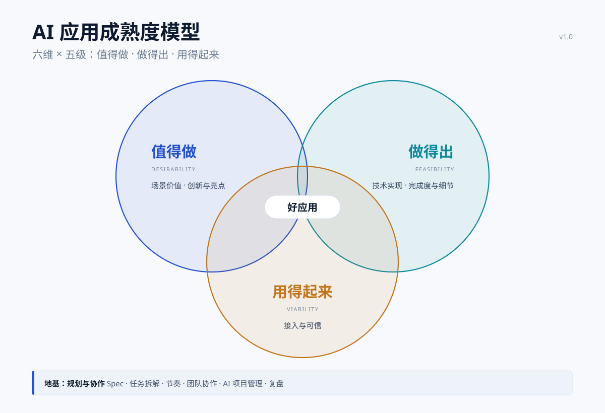

# AI 应用成熟度模型

> AI Application Maturity Model — a six-pillar, five-level self-assessment for developers: where the app stands, and what to improve next.

一句话：**六根支柱 × 五个等级**，每项 0–5 分；看两个数——**整体分**（均值）和**等级**（最低项）；改进只补最低的那一格。

- **六维**：场景价值 · 创新与亮点 · 规划与协作 · 技术实现 · 完成度与细节 · 接入与可信。
- **两个数**：整体分看进度，等级看现在算到哪一级；两者可以不一致，这是正常的。
- **一条硬规矩**：每个分数至少配一件能当场拿出的物件；拿不出，这一格最高 3 分。

**适用**：个人开发者或团队对**单个 AI 应用**做自评、复盘、定迭代目标；也用于方案对比、技术选型、交接前的体检。**不适用**：对外认证、评级；替代任何行业标准。

**30 秒上手**：按第四节自评表，六项各打 0–5 分 → 每项写一件物件 → 算整体分、看最低项 → 下个迭代只补最低的那一项。

配套：**三个示例应用** [examples.md](examples.md)（同一类需求从 L1 到 L5 各长什么样）。

文档结构：三圈 → 六维 × 五级矩阵 → 六维详解 → 打分与读法 → 检测问题 → 三个示例 → 怎么用起来 → 常见问题 → 仓库结构 → 参考与说明 → 许可。

版本 v1.0 · 2026-11 · [](LICENSE)

---

## 一、三圈：值得做 · 做得出 · 用得起来

好应用要同时过三关：**值得做、做得出、用得起来**。三关都过才算站得住；圈外还有一层地基——团队怎么把事做出来。



| 圈 | 在问什么 | 对应支柱 | 为什么放这里 |
|:--|:--|:--|:--|
| **值得做** Desirability | 值不值得投入 | 场景价值、创新与亮点 | 一个解决“谁的痛”，一个解决“凭什么不是你” |
| **做得出** Feasibility | 团队和技术能不能做出来 | 技术实现、完成度与细节 | 一个是能力上限，一个是交付下限 |
| **用得起来** Viability | 能不能被别人持续使用 | 接入与可信 | 有人用 + 有证据，才算真落地 |
| **地基** | 团队靠不靠得住 | 规划与协作 | 讲的是团队，单独作为底座托住三圈 |

## 二、六维 × 五级矩阵

| 支柱 | L1 生成级 | L2 打通级 | L3 能用级 | L4 好用级 | L5 可推广级 |
|:--|:--|:--|:--|:--|:--|
| **等级一句话**<br>（不分支柱） | **能生成**：用 AI 工具生成一个能跑的原型，单点、示例数据 | **能跑完**：一条链路端到端跑通，能交出一个东西 | **能完整走一遍**：真实数据、真实流程，边界说得清 | **别人能复现**：细节、异常、评测补齐，换人能接手 | **别人能照搬**：真实业务用过一次，有收益、可复制 |
| **1 场景价值**<br>谁的痛，多久一次 | 说清了“给谁用”，但没跟使用的人核对过 | 明确了岗位与触发时机，有输入输出口径，但还跑在示例场景上 | 明确岗位 + 流程 + 量化痛点（每周 X 次 / X 小时） | 真实数据在真实流程里跑过，有做前做后的对比 | 已在业务里常态使用，切口小到隔壁团队能照搬 |
| **2 创新与亮点**<br>凭什么不是你 | 用的全是工具自带能力，只加了一段提示词 | 有一处自己的取舍（栏目设计 / 规则 / 口径），能说出为什么这么定 | 有一个明确的“别人第一反应不会这么干”的设计 | 2–3 个意外点，且能说明为什么这么选、代价是什么 | 这个点被别的团队 / 项目拿去用了 |
| **3 规划与协作**<br>团队靠不靠得住 | 边试边改，只有一段对话记录 | 有一条链路的设计（输入 → 处理 → 输出），任务列得出来，但没排期 | 一页 Spec + 任务拆解 + 明确分工 | 有节奏、有版本、有人交接；AI 资产（提示词 / 模型 / 评测集）有版本 | Spec 能被别人接力，复盘能交给下一批人用 |
| **4 技术实现**<br>做得多深 | 工具生成 + 提示词，单点跑通 | 组装：检索、结构化输出、规则校验能串成一条链路 | 调优：微调 / 重排，有 A/B 对比与指标 | 自研：有对照基线 + 消融实验，指标显著更优 | 可验证：方法可复现，被第二个场景复用 |
| **5 完成度与细节**<br>做完了吗、细不细 | 一个页面或一次问答，点完就结束 | 端到端能跑完、能交出一个东西；异常基本没处理 | 主要字段规则齐，能处理 3 类异常输入 | 闭环完整：空态、权限、兜底、错误提示 + 使用说明 | 挑不出漏洞；明确列出“不做什么”，失败样例有备案 |
| **6 接入与可信**<br>能不能真用 | 只在自己电脑上能演示 | 能给同事用，但跑在示例数据上 | 单点嵌进真实流程的一个环节，结论带出处 | 在役：有日志、调用量、异常兜底、评测指标 | 停了会有人找；脱敏与合规可审计，换人能复现 |

> 读法：**同一行从左到右**是这根支柱的成长路径；**同一列从上到下**是这一档应用的样子。六行里最低的一格，就是应用的等级。
>
> L1 不是“有想法”，而是**已经用工具生成出能跑的东西**。工具让这一步变得很便宜，所以它只是入场券：拿得出原型，才谈得上评分。

## 三、六维详解

| 支柱 | 到底在问什么 | 拿得出手的证据（每项至少 1 件） | 容易掉档的地方 | 一句话追问 |
|:--|:--|:--|:--|:--|
| **1 场景价值** | 不是“能不能做”，是“值不值得做”。要看到一个具体的人在具体时刻卡住了。 | ① 岗位 + 流程 + 频次<br>② 量化痛点（每周 X 小时）<br>③ 使用者的需求原话<br>④ 做前做后对比 | 把“场景”写成“功能”；一个应用想覆盖三个部门；痛点靠自己估 | 「这不叫场景，叫功能。谁每周花多少小时在这上面？」 |
| **2 创新与亮点** | 同样的题，凭什么你做得更好。创新不一定是新技术——**一个别人没想到的切法**也算。 | ① 一处“反直觉”的设计<br>② 和通用工具的差异说明<br>③ 为什么这么选、代价是什么<br>④ 被复用的记录 | 把“加了个模板”当创新；创新点说不清价值；为了不一样而不一样 | 「这处设计，别人第一反应为什么不会这么做？」 |
| **3 规划与协作** | 先想清楚再动手，还是边做边想；团队能不能按时交付、能不能交接。 | 见下节六个子项 | 只有聊天记录当文档；Spec 写完就丢；分工模糊 | 「你是先想清楚再做的，还是边做边想的？Spec 在哪？」 |
| **4 技术实现** | 做得多深。**有没有对照和消融**，是“用了深度学习”和“做出技术贡献”的分界线。 | ① 对照基线 + 消融结果<br>② 评测集与指标<br>③ 复现步骤<br>④ 第二个场景的复用证据 | 把“调通了”说成“解决了”；没有基线；只有自己的机器能跑 | 「对照组是什么？去掉你这个模块，指标掉多少？」 |
| **5 完成度与细节** | 闭环有多全 + 同一处有多深。这两件事互相独立：可以“全但粗”，也可以“细但不全”。 | ① 异常处理清单<br>② 空态 / 权限 / 兜底<br>③ 使用说明（可交接）<br>④ 明确的不做清单 | 只演示 happy path；上传错文件就崩；没有文档 | 「用户上传的文件格式不对，你的系统会怎样？」 |
| **6 接入与可信** | 敢不敢让别人真用。这是“有人用 + 有证据”的组合。 | ① 使用人数与频次<br>② 嵌在流程哪一步<br>③ 每条结论的出处<br>④ 评测指标与脱敏说明 | 结论无法溯源；只有自己那台电脑能跑；不提失效场景 | 「现在几个人在用？停了会有人找你吗？」 |

> **证据规则**：每个分数至少配 1 件能当场拿出的物件；拿不出物件的维度，最高 3 分。同一件材料可以给多格作证，但每格要回答自己的问题（见中间一列）——不能拿同一件事把六格一起抬高。

### 规划与协作：六个子项

| 子项 | 它问什么 | 必须拿得出的物件 |
|:--|:--|:--|
| **Spec / Plan** | 动手前想清楚了吗 | 一页纸：用户 / 主流程 / 数据结构 / 验收 / **不做什么** |
| **任务拆解** | 拆得开吗，能并行吗 | 任务清单（8–12 项）+ 依赖关系 + 每项验收方式 |
| **节奏与迭代** | 跑得动吗 | 两周节奏表、推进记录、留了多少缓冲 |
| **团队协作** | 配合得上吗 | 角色分工表、交接物、冲突处理方式 |
| **AI 项目管理** | 用 AI 管项目，也管 AI 的产出 | ① 用 AI 做需求梳理 / 纪要 / 风险预警；② **AI 资产治理**：提示词版本、数据集、模型版本、评测集、AI 生成内容的复核流程 |
| **复盘** | 收得住吗 | 一页复盘：出过什么问题、怎么改、下次怎么避免 |

> 规划是**过程证据**，不是态度描述。没有看板截图、没有一页 Spec、没有复盘记录，这项最多 2 分（打通级）。

## 四、打分与读法

一个应用算到哪一级，不看最长的那根板，看最短的。

- 每项 **0–5 分**（0 = 未做，1–5 对应矩阵的同一档）。
- 六项填完算两个数：
  - **整体分 = 均值**（保留一位小数）：用来看趋势，不看单次绝对值；
  - **等级 = 最低项**（L1–L5；任一项为 0 记「未完成」）：回答“现在算到哪一级”。
- **改进只补最低项**：等级由最低项决定；并列最低时，要一起抬到 +1，等级才会升。补长板的收益远小于补短板。
- 均值高、等级低是常态：整体 3.0、最低项 2 的应用，说明“没有大坑，也没有尖”——它的等级就是 L2。
- 六维**等权**：同一应用按不同权重会算出不同结论，等权规则简单、可复现，也便于自己逐次对比。

> 等级由最弱一环决定：技术再强，没人用也到不了 L4；场景再真，跑不起来也到不了 L3。

### 自评表

| 支柱 | 得分 0–5 | 一件能当场拿出的物件 | 下个迭代补什么 |
|:--|:--:|:--|:--|
| 1 场景价值 |  |  |  |
| 2 创新与亮点 |  |  |  |
| 3 规划与协作 |  |  |  |
| 4 技术实现 |  |  |  |
| 5 完成度与细节 |  |  |  |
| 6 接入与可信 |  |  |  |

| 汇总 | 结果 |
|:--|:--|
| 整体分（均值） | ______ |
| 等级（最低项） | L______ |
| 短板 | ______（并列写多个） |
| 下个迭代只做 | ______ |

读完这张表，应该只得到一个动作：**补哪一格、补到几分**。

## 五、检测问题清单

### 快测：六句话

1. 谁在什么时候用？他现在不用你的系统是怎么做的？（场景价值）
2. 哪一处是“别人第一反应不会这么干”的？（创新与亮点）
3. 一页 Spec 现在能拿出来吗？（规划与协作）
4. 有没有对照基线？去掉你的核心模块，指标掉多少？（技术实现）
5. 文件格式错了、权限不足，界面怎么表现？（完成度与细节）
6. 现在几个人在用？停了会有人找你吗？（接入与可信）

### 完整清单

| 支柱 | 检测问题 | 答不上来意味着 |
|:--|:--|:--|
| 场景价值 | 这件事一周发生几次？每次几个人、多少分钟？ | 不可度量 → ≤ L2 |
| | 谁给你提的需求？他能说出一句抱怨的原话吗？ | 需求是自己想的 → ≤ L2 |
| | 不解决会怎样？有没有人被考核、被投诉？ | 痛感不足 → L3 存疑 |
| | 做前做后的数字是多少？ | 到不了 L4 |
| 创新与亮点 | 你的方案里，哪一处是“别人第一反应不会这么干”的？ | ≤ L2 |
| | 换成通用聊天工具，你的应用还能做到几成？ | 答“九成”= 没有创新 |
| | 这个点是抄的还是改的？改在哪？ | 说不清 → 不计入亮点 |
| | 有没有第二个场景能用这个点？ | 有 → L4+ 潜力 |
| 规划与协作 | 一页 Spec 能拿出来吗？写了“不做什么”吗？ | ≤ L2 |
| | 任务拆成几项？哪两项能并行？ | 拆解 ≤ L2 |
| | 两周节奏是什么？延期过吗，怎么处理的？ | 只有执行、没有计划 |
| | AI 改过几版提示词？上一版的评测结果还在吗？ | AI 资产治理缺失 → 规划 ≤ L3 |
| | 出过最大的问题是什么？复盘写了什么？ | 没有闭环 |
| 技术实现 | 哪一步是“不用模型也能做”的？ | 说不清边界 → L3 存疑 |
| | 有没有对照基线？去掉核心模块，指标掉多少？ | 到不了 L4 |
| | 换个人拿同样数据能复现吗？跑多久？ | L3 上限 |
| | 输入扩大 10 倍、格式错乱，会怎样？ | 工程化不足 → L4 存疑 |
| | 你解决的那个难点，别人通常卡在哪？ | 说不出 → 不算攻坚 |
| 完成度与细节 | happy path 之外，你处理了几类异常？ | ≤1 类 → L2 |
| | 空数据、权限不足、接口超时，界面怎么表现？ | ≤ L2 |
| | 有使用说明吗？换个人能照文档跑起来吗？ | 缺可交接性 → L3 上限 |
| | 哪些功能明确决定不做？为什么？ | 边界不清 |
| | 有没有点进去没反应的地方？ | 有 → 完成度不到 L4 |
| 接入与可信 | 现在几个人用？一周几次？ | 接入 L1 |
| | 是独立工具，还是嵌在流程里？嵌在哪一步？ | 接入 ≤ L2 |
| | 每条结论能指到原文 / 原数据吗？ | 可信 L2 |
| | 数据怎么脱敏的？合规上谁签过字？ | 合规缺失 |
| | 停了会有人找你吗？ | 答“不会”→ 接入 ≤ L3 |

## 六、三个示例：同一类需求，三种成熟度

同一个场景（AI 辅助投资尽调），三个应用的六维分与两个输出。

| 维度 | A「会聊天的尽调助手」 | B「能用的尽调工作台」 | C「接进流程的尽调系统」 |
|:--|:--|:--|:--|
| **场景价值** | 想象中的“投资部应该用得上”，没有具体人 | 尽调岗每周 3 次、每次整理 4 小时（访谈了 3 个人） | 两个尽调组常态使用，周期从 6.8 天降到 2.6 天 |
| **创新与亮点** | 换了一个更长的提示词 | 把尽调清单拆成 12 个固定栏目，每条结论带出处 | 自研条款抽取（对赌 / 回购 / 代持）+ 交叉核对机制；代价是标注与维护成本高 |
| **规划与协作** | 需求散在聊天记录里，做到哪算哪 | 一页 Spec + 12 项任务 + 两周节奏 + 3 人分工 | Spec 可交接、提示词与模型版本化、每轮复盘 |
| **技术实现** | 直接调通用模型，一次问答 | RAG + 结构化输出 + 规则校验；栏目抽取做过 A/B，命中率 78% → 86% | 自研抽取模型：有基线、有消融、300 条评测集；方法复用到投后管理 |
| **完成度与细节** | 一个页面，贴进财报出摘要，格式一错就空白 | 四页闭环，处理 3 类异常，写了使用说明 | 空态 / 权限 / 兜底齐全，写明不做什么，失败样例有备案 |
| **六维分** | 1·1·1·1·1·1 | 3·2·3·3·4·3 | 5·4·5·5·5·5 |
| **整体分（均值）** | **1.0** | **3.0** | **4.8** |
| **等级（最低项）** | **L1** | **L2（创新 2）** | **L4（创新 4）** |

### 差距在哪

- **A**：六格全 1。有一个 demo，但没有链路、没有真实数据、没有使用记录——整体 1.0，等级 L1。
- **B**：整体 3.0，六格都不低于 L2；但创新只有 2（12 个栏目是“自己的取舍”，还不是“别人不会这么干”），等级因此停在 L2。**这是最常见的形态：没有大坑，但也没有尖。**
- **C**：只差创新一维。条款抽取是 2–3 个意外点（4 分），但还没被别的团队复用（5 分要有复用记录），所以整体 4.8、等级 L4。

### 最该补的一格

| 应用 | 一句话追问 | 说明什么 |
|:--|:--|:--|
| A | 「这套东西，换个人能跑起来吗？」 | 不能 → 停在 L1 |
| B | 「创新这一格，凭什么不是 2 分？」 | 答得出 → 等级才可能到 L3 |
| C | 「这个点被别的团队用过吗？」 | 用过 → 创新 5、等级 L5；没用过 → 停在 L4 |

## 七、怎么用起来

### 1. 第一次自评（15 分钟）

1. 按自评表逐项打分，**每个分数配一件物件**；写不出按「无证据」处理，这一项最高 3 分。
2. 算整体分，记下最低项（= 等级）。
3. 只选最低项作为下个迭代的目标；并列时先选最影响交付的那一项。

### 2. 定目标与下一步

- 目标等级 = 当前等级 + 1，不跳级；有多个最低项时，分几次把它们都抬到 +1。
- 从矩阵里取「最低项 + 1」那一格，看它要求什么物件；下个迭代只做那一件。
- 例：等级 L2、卡在创新 → 只做“别人第一反应不会这么干”的那一处设计，其余五格不动。

### 3. 迭代末复评（15 分钟）

- 只回答一个问题：**最低项动了吗？**
- 动了 → 重算等级；没动 → 说明做的不是那一格，回退目标。
- 连续两次没动 → 目标定得太大，拆小。

### 4. 团队互评（可选，30 分钟）

- 两人交换打分；同一项差 **≥2 分**，各自出示物件，谁拿不出谁让步。
- 分歧点就是下一次自评的重点。

### 5. 记录趋势

- 一张表：日期 / 六维分 / 整体分 / 等级 / 本期补的那一项。
- 趋势比绝对值重要；连续三次不动，说明目标或方法有问题。

## 八、常见问题

**Q1：适合什么应用？**
任何形态：Agent、RAG、工作流、模型服务、带 AI 的传统系统。六维是**领域无关的刻度**，只描述“做到什么程度”，不规定“做什么”。

**Q2：偏技术的应用会不会吃亏？**
不会。「技术实现」的 L4/L5 判据是**对照基线 + 消融 + 可复现**，技术深度直接体现在这一格的分数上。六维等权，避免同一应用按不同权重算出两套结论。

**Q3：只有文档、没跑起来，怎么评？**
「完成度与细节」记 0–1 分；任一项为 0，等级记「未完成」。先做一个能点开的原型，再谈评分。

**Q4：分数要不要精确到 0.5？**
不必。整数足够；有分歧就回到证据，不靠小数点决胜。

**Q5：会不会把应用做成一个样？**
不会。模型只定义“做完的样子”，不定义“做什么”；同样的六格，做投资、产线、客服填出来完全不同。

**Q6：自评普遍偏高怎么办？**
两条约束：① 每个分数配一件物件；② 找一个人复核，用「一句话追问」反查——答不上来按「无证据」处理（最高 3 分）。

**Q7：整体分高、等级低，怎么读？**
正常。等级看短板，整体分看进度；改进看等级，汇报看趋势。只报整体分，等于把短板藏起来。

**Q8：多久评一次？**
每个里程碑或每季度一次；同一个应用至少评三次，才看得出趋势。

## 九、仓库结构

```text
README.md                       本文件：模型正文
examples.md                     3 个示例 × L1–L5
images/maturity-venn.svg        三圈关系图（可编辑）
CHANGELOG.md                    版本记录
LICENSE                         MIT
```

## 十、参考与说明

- 三圈框架（Desirability / Feasibility / Viability）来自设计思维里的产品判断三问，见 Tim Brown, [Design Thinking](https://hbr.org/2008/06/design-thinking), Harvard Business Review, 2008。
- 技术实现的分级参考技术成熟度（TRL）从“概念验证 → 实验室 → 真实环境部署”的递进思路，见 [Technology readiness level](https://en.wikipedia.org/wiki/Technology_readiness_level)。
- “拿不出证据最高 3 分”参考了以证据为中心的评分表（rubric）实践，例如 [AAC&U VALUE rubrics](https://www.aacu.org/initiatives/value-initiative/value-rubrics)。
- 本模型是**自评工具**，不是认证或评级标准；分数用于定位改进点，不用于对外评级。
- 尚未做大规模校准：2 / 3 / 4 的分界是经验刻度，不是统计结论；样例为按矩阵推演的示意，不对应真实项目。
- v1.0 起六维等权（早期草稿曾按应用型 / 技术型设两套权重）：同一应用会得出两套结论，等权更便于逐次对比。
- 三圈图源文件在 [images/maturity-venn.svg](images/maturity-venn.svg)，可直接改文字与配色。

## 许可

[MIT](LICENSE) © 2026
